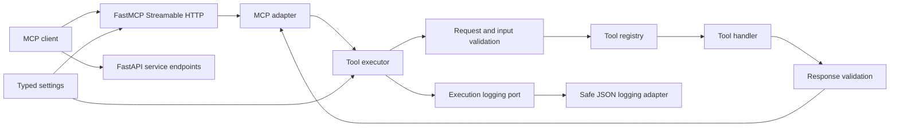
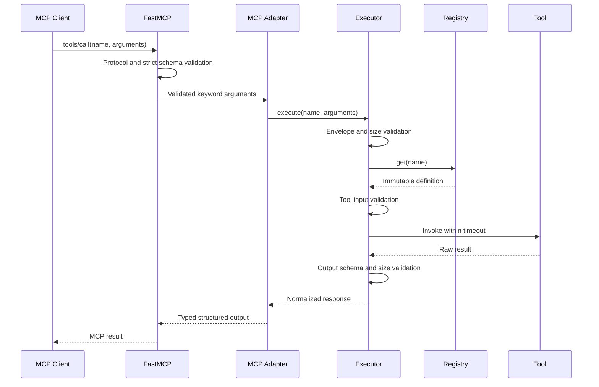

# Architecture

## Purpose

ToolBridge exposes validated, observable tools to MCP clients. Version `0.2.0` implements the Foundation and MCP Core while keeping production tools and providers outside the current boundary.

## Current architecture

One Python process still hosts FastAPI and FastMCP. The existing `/`, `/health`, `/docs`, and `/mcp/` interfaces are unchanged. The FastAPI lifespan starts the MCP session manager once and stops it with the application.

## Clean Architecture boundaries

### Domain contracts

`toolbridge/core/contracts.py` defines framework-independent tool input/output bases, immutable definitions, discovery metadata, execution requests/responses, and stable error codes. The core imports Pydantic for schema validation but does not import FastAPI or FastMCP.

`toolbridge/core/errors.py` defines normalized internal exceptions with safe public messages. Raw handler exceptions never become client messages.

### Application services

- `ToolRegistry` owns unique registration, lookup, and deterministic discovery.
- `RequestValidator` bounds JSON size, validates the execution envelope, applies strict tool schemas, and forbids extra fields.
- `ResponseValidator` validates declared output models, converts them to JSON-compatible data, and enforces response limits.
- `ToolExecutor` coordinates lookup, validation, timeout, invocation, output validation, normalized outcomes, correlation IDs, and logging.

### Ports and adapters

- `ExecutionEventLogger` is the core logging port.
- `StructuredExecutionEventLogger` is the standard-library JSON logging adapter. It emits only allowlisted metadata.
- `MCPToolAdapter` maps registry definitions to FastMCP discovery schemas and delegates execution to the core.
- `toolbridge/bootstrap.py` composes the registry, validators, executor, logger, and approved tool definitions.

### Tools

`toolbridge/tools/system.py` remains the Phase 1 diagnostic implementation. `toolbridge/tools/definitions.py` supplies its typed core input/output contract without changing the public tool name or output fields.

## Request lifecycle

Cancellation is logged and propagated rather than converted into a normal response. Async handlers can be cancelled cooperatively. Synchronous handlers run in a worker thread; a timeout stops waiting for them but cannot forcibly terminate the Python thread.

## Discovery

The registry is the project source of truth. Definitions are returned alphabetically and contain name, description, input schema, output schema, and timeout. The MCP adapter projects the same fields into FastMCP.

FastMCP currently creates its own argument model with permissive defaults. The adapter contains one isolated, tested compatibility seam that updates this generated model to strict, extra-forbidden, input-hidden validation. This uses the SDK's internal tool manager because version `1.29.0` has no public post-registration hook. Dependency upgrades must run adapter and protocol tests.

## Error model

| Code | Meaning | Retryable |
| --- | --- | --- |
| `invalid_request` | Envelope, JSON, size, or input-schema failure | No |
| `tool_not_found` | No registered definition matches the name | No |
| `duplicate_tool` | Startup registration conflict | No |
| `execution_timeout` | Tool exceeded its configured time | Yes |
| `execution_cancelled` | Caller or server cancelled execution | Not returned; propagated |
| `execution_failed` | Unexpected handler failure | No |
| `invalid_response` | Output violated schema, encoding, or size | No |

Client-visible errors contain a safe message, retryability, correlation ID, and bounded non-sensitive details. Logs contain error codes and exception type only, never exception messages.

## Configuration

The MCP Core adds:

- `TOOLBRIDGE_TOOL_TIMEOUT_SECONDS`
- `TOOLBRIDGE_MAX_REQUEST_BYTES`
- `TOOLBRIDGE_MAX_RESPONSE_BYTES`

Settings are typed and bounded. The default timeout is applied to the registered diagnostic tool and will become the default for approved future definitions.

## Current interfaces

| Interface | Behavior |
| --- | --- |
| `GET /` | Name, version, status, and endpoint locations |
| `GET /health` | Cheap process-liveness response and environment label |
| `GET /docs` | FastAPI-generated documentation |
| `/mcp/` | Stateless MCP Streamable HTTP endpoint with JSON responses |
| `system_status` | Validated service name, status, and UTC ISO timestamp |

## Current constraints

- Only the diagnostic tool exists; Phase 3 tools are not implemented.
- No authentication, authorization, rate limiting, provider routing, or persistence.
- No readiness endpoint because there are no required external dependencies.
- No distributed traces or metrics; structured logs cover tool execution only.
- No Docker or CI/CD artifacts.
- The FastMCP strict-validation compatibility seam requires upgrade tests.
- Timed-out synchronous handlers cannot be forcibly stopped after their worker thread begins.

## Target direction

Phase 3 may add approved deterministic tools through the existing definition and registry contracts. Later phases may add provider adapters, routing, optional agent orchestration, persistence, UI, production security, observability, and deployment artifacts. None are implemented in `0.2.0`.
