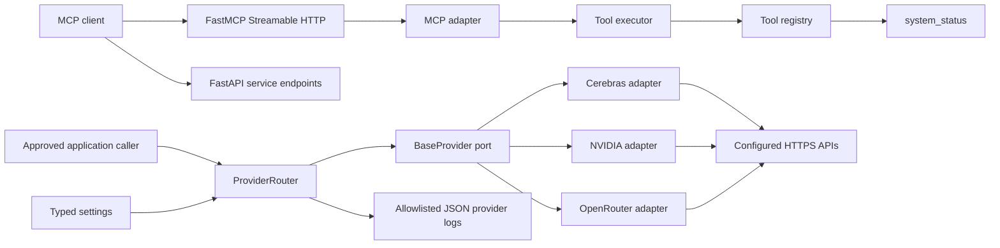
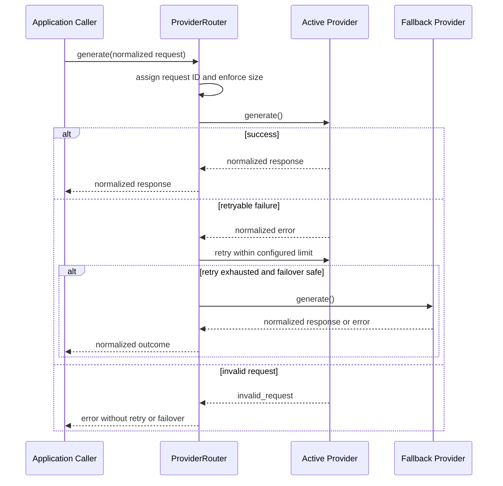

# Architecture

## Purpose

ToolBridge exposes validated, observable capabilities to MCP clients and internal application callers. Version `0.3.0` implements the Foundation, MCP Core, and provider-neutral LLM routing. No provider-backed MCP production tool exists yet.

## Current architecture

One Python process still hosts FastAPI, FastMCP, the MCP Core, and the provider router. The existing `/`, `/health`, `/docs`, `/mcp/`, and `system_status` interfaces remain intact. Provider adapters are disabled by default and no network calls occur unless explicitly configured and invoked.

## Clean Architecture boundaries

### Domain

`toolbridge/providers/domain` contains provider-neutral request, response, stream, model, usage, health, status, and error contracts. It has no FastAPI, FastMCP, HTTP client, or vendor SDK dependency.

Normalized error categories are:

- `timeout`
- `authentication`
- `rate_limit`
- `unavailable`
- `invalid_request`
- `invalid_response`
- `internal`

### Application

`toolbridge/providers/application/ports.py` defines `BaseProvider`. Every provider implements `initialize()`, `health_check()`, `list_models()`, `generate()`, `stream_generate()`, and `close()`.

`ProviderRouter` owns:

- configured provider ordering and active-provider state,
- bounded retry and exponential backoff,
- safe failover classification,
- request identifiers and request-size enforcement,
- provider status, latency, last-success, and last-failure state,
- cancellation-preserving generation and streaming behavior.

The application layer does not depend on FastAPI or provider adapters.

### Adapters

`toolbridge/providers/adapters` implements Cerebras, NVIDIA, and OpenRouter through one shared OpenAI-compatible HTTP adapter. Provider classes remain independently replaceable behind `BaseProvider`. Vendor response bodies and exceptions are translated into domain contracts and never escape the adapter boundary.

The shared adapter owns:

- Bearer authentication,
- model discovery,
- chat-completion request mapping,
- JSON response normalization,
- server-sent event parsing,
- HTTP and transport error classification,
- provider-specific request limits.

### Infrastructure

`toolbridge/providers/infrastructure/factory.py` unwraps secrets only while composing enabled outbound adapters. It supplies typed provider configuration, priority, retry policy, and injectable HTTP transports.

`toolbridge/providers/infrastructure/logging.py` implements the provider logging port. It emits only timestamp, level, provider, latency, status, request ID, and error category.

`toolbridge/bootstrap.py` composes the unchanged MCP Core with the provider router. `toolbridge/main.py` starts and closes provider resources through the existing FastAPI lifespan but does not contain routing logic.

## Provider request lifecycle

The default priority is Cerebras, NVIDIA, then OpenRouter. Priority is configuration, not router code. A successful request makes that provider active. On-demand health checks probe all enabled providers concurrently and restore the highest-priority healthy provider.

## Retry and failover policy

| Category | Retry same provider | Fail over |
| --- | --- | --- |
| Timeout | Yes | Yes after exhaustion |
| Rate limit | Yes | Yes after exhaustion |
| Unavailable | Yes | Yes after exhaustion |
| Authentication | No | Yes |
| Invalid response | No | Yes |
| Internal | No | Yes |
| Invalid request | No | No |

Backoff starts at the configured delay, doubles per retry, and is capped by configuration. A valid `Retry-After` duration is honored up to the same cap.

For streaming, retry and failover are permitted only before the first chunk. After any content is emitted, failures propagate without failover to prevent duplicated partial output.

## Health model

Each provider has an immutable public snapshot containing:

- provider identifier,
- `uninitialized`, `healthy`, `degraded`, `unavailable`, or `closed` status,
- latest observed latency,
- last successful request timestamp,
- last failed request timestamp,
- last normalized error category.

Provider health is currently checked on demand. `/health` remains process liveness and deliberately does not call external providers. A readiness endpoint and background probe scheduler are deferred until deployment requirements are approved.

## Configuration boundary

Provider keys, enabled state, HTTPS base URLs, model identifiers, endpoint paths, timeouts, retries, maximum tokens, temperature, prompt size, provider priority, and retry timing are typed settings. Enabled providers require an API key and explicit default model. Secrets are represented by `SecretStr` and unwrapped only in infrastructure composition.

## Existing MCP Core

The Phase 2 registry, validators, executor, error model, MCP adapter, and execution logging remain unchanged. The only MCP tool remains `system_status`; provider routing is an internal application service until an approved Phase 4 tool consumes it.

## Current constraints

- Provider-backed MCP tools are not implemented.
- Provider health monitoring is on demand rather than scheduled.
- There is no provider readiness HTTP endpoint, circuit-breaker cooldown, global concurrency control, or budget ledger.
- Real-provider contract tests require explicit credentials and remain outside the default offline suite.
- Authentication, authorization, inbound rate limiting, persistence, agents, UI, Docker, and CI/CD remain unimplemented.
- The FastMCP strict-validation compatibility seam still requires regression tests on SDK upgrades.
- The service remains local-development only and must not be exposed to untrusted networks.

## Target direction

Phase 4 may add one owner-approved provider-backed or deterministic MCP tool through the existing MCP Core and provider contracts. Agent orchestration, production hardening, observability expansion, and deployment remain later phases and are not implemented in `0.3.0`.
