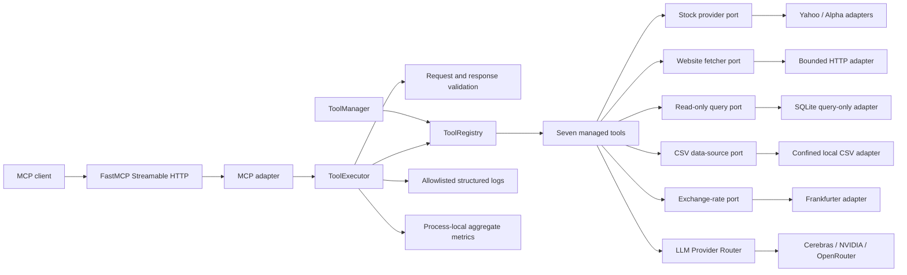
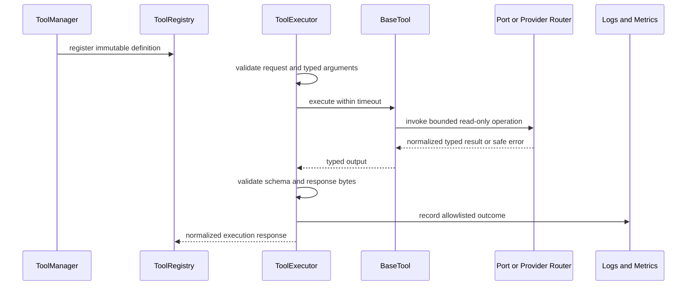

# Architecture

## Purpose and current state

ToolBridge exposes validated, observable capabilities to MCP clients. Version `0.5.0` implements the Foundation, MCP Core, LLM Provider Router, reusable Core Tool Framework, Stock Price Tool, and the five remaining approved Core MCP Tools.

One Python process hosts FastAPI, FastMCP, MCP Core, managed tools, and the Provider Router. Existing `/`, `/health`, `/docs`, `/mcp/`, and Phase 1–4 tool interfaces remain compatible. Startup creates local clients and resources but performs no provider, website, database, or file request.

## Clean Architecture boundaries

### Domain

`toolbridge/tools/domain` owns strict input/output models, health and metric states, normalized identifiers, and safe tool errors. It contains no FastAPI, FastMCP, HTTP client, SQLite connection, or filesystem implementation.

`toolbridge/providers/domain` remains the provider-neutral LLM contract.

### Application

`BaseTool` and `ToolManager` remain unchanged. Each Phase 5 tool supplies an immutable `ToolDefinition`, lifecycle methods, health status, and a small handler that delegates to a project-owned port.

`phase5_ports.py` defines replaceable boundaries for website retrieval, database querying, CSV analysis, and exchange rates. `LLMAnalysisTool` delegates to the existing Provider Router, which hides all vendor adapters.

The existing Phase 2 executor remains the only validation, timeout, response, normalized-error, logging, and metrics pipeline.

### Adapters

- `HttpWebsiteFetcher` validates public destinations, refuses redirects, streams bounded text responses, and removes common HTML boilerplate.
- `SQLiteReadOnlyQueryExecutor` opens only the configured database, sets SQLite query-only mode, runs in a worker thread, uses a progress-handler deadline, and bounds rows and JSON-safe values.
- `LocalCSVDataSource` confines resolved paths beneath one root and bounds bytes, rows, columns, fields, and previews before returning summaries.
- `FrankfurterExchangeRateProvider` maps configured HTTPS responses into normalized rate sets with bounded streaming and stable error categories.
- Existing stock and LLM adapters are unchanged.

### Infrastructure

`phase5_config.py` contains typed settings. `phase5_factory.py` composes Phase 1–5 tools and injects the process-owned Provider Router. `bootstrap.py` creates the Provider Router before constructing its dependent LLM tool, then registers every enabled tool through the unchanged manager.

## Common tool lifecycle

## Tool-specific flows and controls

### Website Reader

Input requires credential-free HTTPS on port 443. Optional exact-host allowlisting and public-address resolution reduce SSRF risk. Local, private, link-local, reserved, multicast, and unspecified destinations are rejected before HTTP. Redirects and non-text content are refused. Response bytes and extracted characters are bounded.

DNS resolution and connection are separate operations, leaving a documented DNS-rebinding time-of-check/time-of-use risk. Production requires outbound firewall enforcement and an explicit host allowlist.

### SQL Query

The domain validator accepts one `SELECT` or `WITH` statement and rejects comments, separators, and mutating or transaction keywords. Named parameters are passed separately. SQLite opens configured files in URI read-only mode and also enables `PRAGMA query_only`. A progress callback interrupts long computation; the executor supplies an outer timeout. The port is database-neutral, but PostgreSQL has no runtime adapter in Phase 5.

### CSV Analysis

Only relative `.csv` paths are accepted. Resolved paths must remain under the configured root. Analysis occurs in a worker thread. File size, scan rows, columns, field characters, and preview rows are bounded. Returned cells remain untrusted data.

### Currency Converter

Validated ISO codes and finite positive amounts enter a cache keyed by source and ordered targets. Cache misses are coalesced. The provider is retried only for normalized retryable failures with capped exponential backoff. Only successful, bounded, schema-valid rate sets are cached.

### HCL Curie / LLM Analysis

The tool constructs a provider-neutral `GenerationRequest`, uses a fixed system safety instruction, treats supplied text as document data, and delegates retries, priority, failover, secrets, and provider logs to the existing Provider Router. It does not expose streaming, tool calls, agents, or provider-specific types. Model output remains untrusted.

## Configuration and trust boundaries

Phase 5 settings use `TOOLBRIDGE_PHASE5__<TOOL>__...`. No Phase 5 tool requires a secret. LLM providers retain their existing secret settings. External origins require HTTPS; local database and CSV paths are configuration-controlled and confined.

Core logs contain only tool name, correlation identifier, duration, status, error code, and safe exception type. Provider logs retain their Phase 3 allowlist. URLs, queries, SQL, parameters, filenames, CSV cells, prompts, source text, results, credentials, and provider bodies are excluded.

## Current constraints

- Local-development only; no inbound authentication, authorization, rate limiting, tenancy, or production network policy
- Runtime SQL adapter is SQLite-only
- No shared cache, persistence layer, scheduled health, circuit breaker, readiness endpoint, global concurrency control, or budget ledger
- Website DNS-rebinding residual risk and external content licensing/privacy obligations
- CSV and database files require operator-controlled permissions and data governance
- Exchange-rate coverage, freshness, availability, and terms depend on the configured provider
- LLM output is untrusted and provider use can incur cost
- Live external contract tests remain opt-in and excluded from the offline suite
- Dashboard, agents, CI/CD, packaging, deployment, and later phases are unimplemented

## Target direction

Phase 6 may begin only after project-owner acceptance of Phase 5 and explicit scope approval. No Phase 6 functionality is part of version `0.5.0`.
