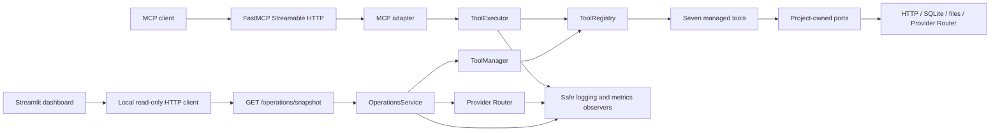
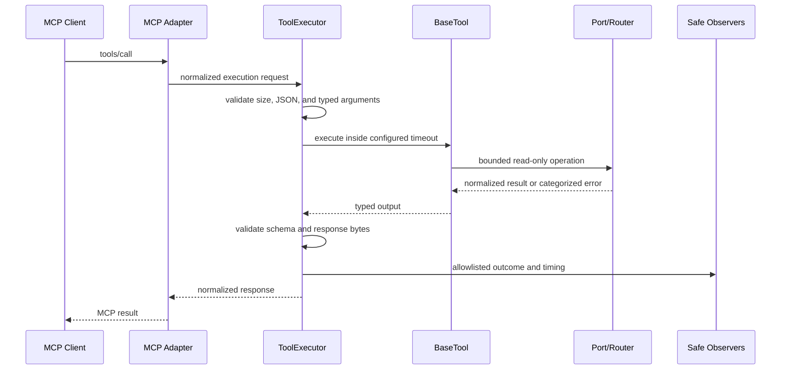
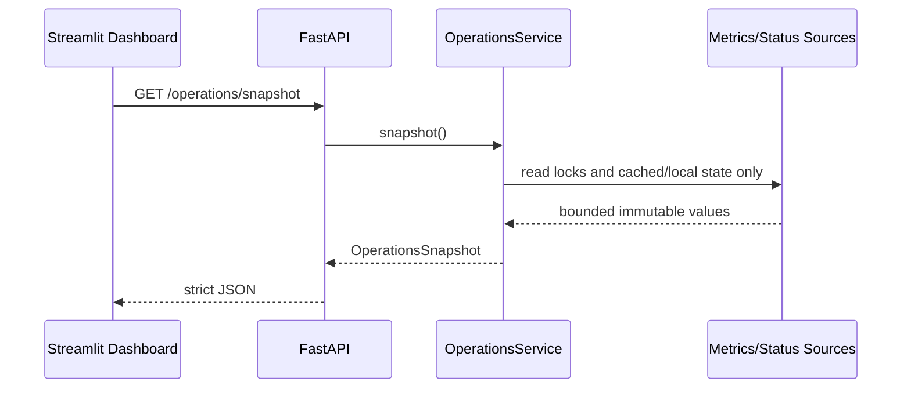
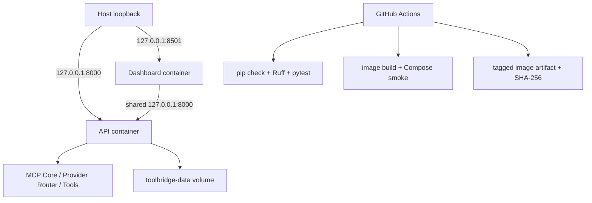

# Architecture
> Current release architecture: ToolBridge v1.0.0, Phase 7 deployment prepared.

## Purpose and current state

ToolBridge `1.0.0` is a loopback-only deployable MCP service with seven read-only tools and a separate read-only Streamlit operations dashboard. One API process hosts FastAPI, FastMCP, MCP Core, managed tools, the Provider Router, and process-local operational state. Streamlit runs as a second process and reads one safe HTTP snapshot. Local development uses two host processes; Compose uses two hardened containers.

Existing `/`, `/health`, `/ready`, `/operations/snapshot`, `/docs`, `/mcp/`, and all seven MCP tool contracts remain compatible. Startup performs no provider, website, stock, exchange-rate, database, or file request.

## Clean Architecture boundaries

### Domain

- `toolbridge/core/contracts.py`: stable MCP execution contracts and errors
- `toolbridge/tools/domain`: tool input/output, health, and metric models
- `toolbridge/providers/domain`: provider-neutral generation, status, usage, and error models
- `toolbridge/operations/domain`: immutable readiness, system, provider, tool, metric, cost, and safe-log snapshot models

Domain modules contain no FastAPI, FastMCP, Streamlit, HTTP client, database, or filesystem implementation.

### Application

- `ToolExecutor` owns request/response validation, timeouts, error normalization, cancellation, and execution observers.
- `ToolManager` owns registration and lifecycle. Phase 6 adds cached monitoring snapshots so dashboard reads do not trigger external tool health checks.
- `ProviderRouter` owns provider priority, retries, failover, lifecycle, status, and normalized generation. A provider-usage observer receives only provider identity and normalized token counts.
- `OperationsService` owns startup validation, lifecycle/readiness decisions, and aggregation into immutable safe snapshots.
- `InMemoryOperationalMetrics` is a bounded observer for tool/provider timing, provider usage/cost estimates, error categories, and recent allowlisted events.

Application code remains independent of FastAPI, FastMCP, and Streamlit.

### Adapters

- FastMCP projects registry definitions into MCP discovery/execution.
- Existing Yahoo/Alpha Vantage, website, SQLite, CSV, Frankfurter, and LLM HTTP adapters remain unchanged.
- FastAPI exposes liveness, readiness, and safe operational snapshot transport routes.
- `DashboardClient` performs a credential-free local `GET`, refuses redirects, and validates the JSON against strict domain models.
- Streamlit renders the immutable snapshot and exposes no server mutation operation.

### Infrastructure and composition

`config.py` owns typed provider, tool, operational, readiness, dashboard, and price settings. `bootstrap.py` composes console loggers with bounded operational observers, builds the Provider Router, builds/registers tools, and creates `OperationsService`. `main.py` coordinates startup validation and the MCP/provider/tool lifespan.

## Request and execution flow

## Operational flow

The operational read path performs no provider, stock, website, database, exchange-rate, or file probe. Provider status reflects lifecycle and prior routed operations. Tool health reflects cached lifecycle or an explicitly requested health probe elsewhere.

## Liveness, readiness, and lifecycle

- `/health` is cheap liveness and remains independent of optional external systems.
- `/ready` returns `200` only when the lifespan is ready, registry composition is valid, all configured tools initialized, and Provider Router initialization completed. It returns `503` otherwise.
- Optional settings may additionally require an active LLM provider or all cached tool states to be healthy.
- startup validation checks a non-empty version and one-to-one manager/registry composition before traffic readiness.
- readiness changes to stopping before provider/tool resources close.
- lifecycle failures are recorded by safe category without exception text.
- `ToolManager.close()` and Provider Router closure preserve existing idempotent resource ownership.

## Metrics, cost, and logs

Tool metrics count starts, successes, failures, average/last duration, last error category, and last completion time. Provider monitoring includes configured/enabled state, priority, active/failover state, status, last latency/timestamps/error, generation requests, and token counts.

Cost estimates are computed from configured input/output USD-per-million-token values. Defaults are zero. Streaming generations count as requests, but token counts remain zero when the normalized stream contract supplies no usage; the system never invents usage.

Recent logs use a bounded `deque` with a configured capacity. Stored fields are limited to timestamp, level, source, event, component, status, latency, safe request identifier, and error category. They are process-local and not an audit record.

## Configuration and trust boundaries

Phase 6 settings use `TOOLBRIDGE_OPERATIONS__...`. Provider cost rates remain alongside each provider’s typed settings. The dashboard API URL must be loopback and cannot contain credentials, query data, or fragments.

MCP arguments, provider responses, website content, SQL, database values, file paths, CSV data, model output, environment variables, and external errors remain untrusted. Operational output explicitly excludes API keys, authorization headers, prompts, tool arguments/results, URLs, queries, SQL, parameters, paths, filenames, cells, content, provider bodies, and exception messages.

## Current constraints

- local-only; no authentication, authorization, tenancy, inbound rate limits, or public dashboard exposure
- no persistent metrics/audit backend, distributed cache, tracing, scheduled health probes, alert delivery, or horizontal orchestration
- process-local values reset on restart and do not aggregate across workers
- cost estimates depend on operator-configured prices and provider-reported usage
- existing external-contract, data-governance, licensing, and DNS-rebinding risks remain
- no agent, inbound identity system, public network topology, automated deployment, or post-v1 business features

## Phase boundary

Phase 7 deployment and v1.0.0 release preparation are complete and await owner approval. No post-v1 phase is authorized.

## Phase 7 deployment architecture

The release adds only outer operational adapters and packaging; domain, application, MCP Core, provider, and tool contracts are unchanged.

### Container boundary

- `builder` installs pinned runtime dependencies into `/opt/venv`; the runtime stage copies only the environment and `toolbridge/` package.
- the runtime uses Python 3.12 slim and fixed non-root UID/GID 10001.
- Compose makes roots read-only, supplies a bounded writable `/tmp`, drops all capabilities, and enables `no-new-privileges`.
- the API binds `0.0.0.0` only inside its container; Docker publishes it to host loopback only.
- the dashboard shares the API network namespace, calls the API through shared loopback, and listens on the container namespace so Docker can publish it only to host loopback; the typed loopback-only API validator remains unchanged.
- environment settings are external; `.env` is never copied into the image. `/app/data` uses a named persistent volume.

### Automation boundary

CI is a validation and artifact pipeline, not a deployment authority. It uses read-only repository permission, builds and starts the same Compose topology, runs the release verifier, and creates image artifacts only for tags. Publishing, signing, environment promotion, secrets, and rollback execution remain owner/platform responsibilities.
