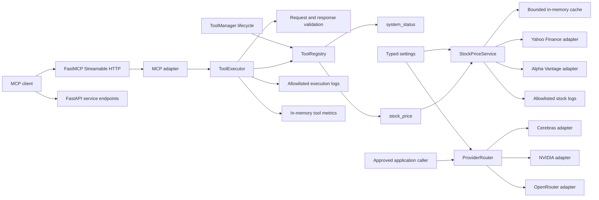
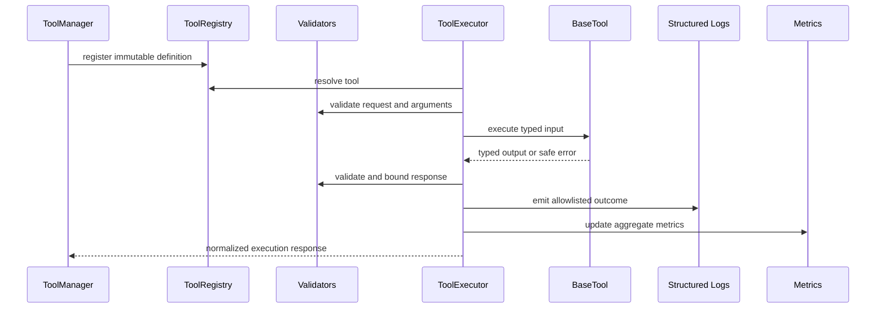
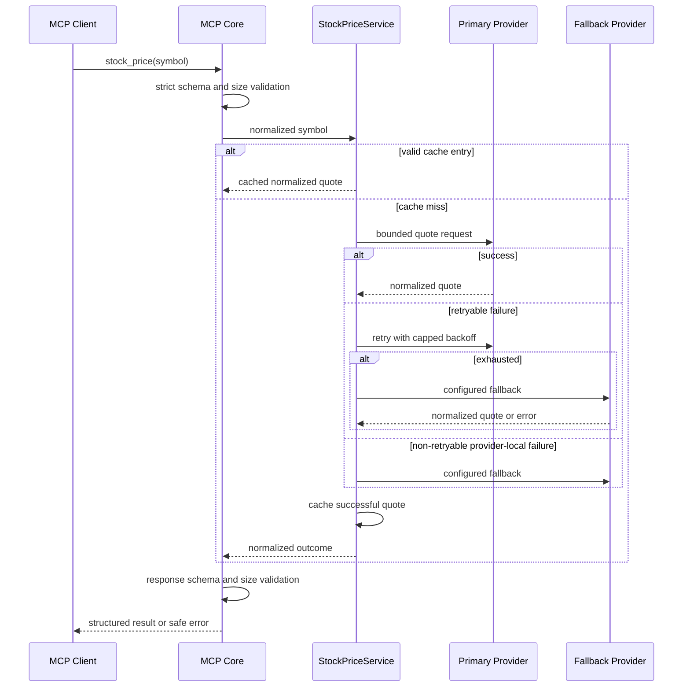

# Architecture

## Purpose

ToolBridge exposes validated, observable capabilities to MCP clients and internal callers. Version `0.4.0` implements the Foundation, MCP Core, LLM Provider Router, reusable Core Tool Framework, and the read-only Stock Price Tool.

## Current architecture

One Python process hosts FastAPI, FastMCP, MCP Core, the managed tools, and the LLM Provider Router. The existing `/`, `/health`, `/docs`, `/mcp/`, and `system_status` interfaces remain compatible. `stock_price` is registered automatically. Startup creates HTTP clients but performs no external health probe or quote request.

## Clean Architecture boundaries

### Domain

`toolbridge/tools/domain` contains provider-neutral tool health, metric, stock quote, market status, provider identifier, and safe error contracts. It has no FastAPI, FastMCP, HTTP client, or provider SDK dependency.

`toolbridge/providers/domain` retains the Phase 3 LLM contracts.

### Application

`toolbridge/tools/application/ports.py` defines:

- `BaseTool`: definition, initialize, health check, and close lifecycle
- `StockQuoteProvider`: provider-neutral quote and health behavior
- `StockProviderEventLogger`: safe logging boundary

`ToolManager` owns automatic registration, ordered initialization, rollback, concurrent health inspection, metrics snapshots, and reverse-order shutdown.

`StockPriceService` owns provider priority, bounded retries, capped backoff, safe failover, per-symbol request coalescing, and the bounded time-based cache. `StockPriceTool` owns the MCP definition and typed input/output boundary. Neither depends on FastAPI or FastMCP.

`ProviderRouter` remains the Phase 3 LLM application service and is independent of the Stock Price Tool.

### Adapters

`toolbridge/tools/adapters` implements Yahoo Finance and Alpha Vantage with the existing asynchronous `httpx` dependency. Both translate external status codes, transport errors, and payloads into project-owned contracts.

The shared HTTP adapter owns:

- explicit client initialization and shutdown,
- configured timeouts and safe HTTPS origins,
- redirect refusal,
- response-size bounds,
- timeout, network, authentication, rate-limit, unavailable, invalid-symbol, and invalid-response normalization.

Yahoo mapping supplies the broad stock output when present. Alpha Vantage `GLOBAL_QUOTE` is an optional fallback and intentionally returns null company, currency, and exchange fields plus `unknown` market status because that endpoint does not supply them.

### Infrastructure

`toolbridge/tools/infrastructure/factory.py` builds enabled provider adapters from typed settings, unwraps the optional Alpha Vantage secret only at composition, orders providers, and returns managed tools.

`toolbridge/tools/infrastructure/logging.py` emits only timestamp, level, event, tool name, provider, operation ID, latency, status, and error category. Symbols, API keys, URLs, payloads, and exception messages are excluded.

`toolbridge/bootstrap.py` composes tools, registry, validators, executor, execution logger, metrics observer, provider router, and tool manager. `toolbridge/main.py` only owns transport and process lifespan.

## Tool lifecycle

The Phase 2 executor remains the single execution pipeline. The Phase 4 framework composes tools into it rather than duplicating validation, errors, or transport behavior.

## Stock request lifecycle

Syntactically unsafe symbols are rejected before network access. A symbol reported invalid by every attempted source returns `invalid_symbol`. Retryable provider failures are retried per provider and then failed over; exhaustion returns `data_source_unavailable`. Caller cancellation propagates.

## Retry, cache, and failover policy

| Category | Retry same source | Fail over |
| --- | --- | --- |
| Timeout | Yes | Yes |
| Network | Yes | Yes |
| Rate limit | Yes | Yes |
| Unavailable | Yes | Yes |
| Authentication | No | Yes |
| Invalid response | No | Yes |
| Invalid symbol | No | Yes to check provider coverage |

Backoff, retry count, timeout, cache duration, cache size, provider priority, health symbol, provider paths, origins, and response limits are typed configuration. Cache entries are per-process, successful responses only, time-bounded, and size-count-bounded. The cache is not persistent or shared across workers.

## Health and metrics

Every managed tool exposes a typed health snapshot. `system_status` reports local lifecycle health. `stock_price` explicitly probes each enabled provider with the configured non-secret health symbol and reports healthy, degraded, or unavailable. Probes are on demand and never run from `/health`.

Metrics retain only bounded aggregates by registered tool name:

- total executions,
- successes and failures,
- average and last duration,
- last error category.

Correlation identifiers, symbols, arguments, responses, and credentials are not retained in metrics.

## Configuration and trust boundaries

Stock configuration is nested under `TOOLBRIDGE_STOCK_PRICE__`. External origins must be HTTPS without credentials, query strings, fragments, or embedded paths. Relative request paths cannot override an authority or traverse directories. Symbols and output values are schema-validated, response bodies are bounded, redirects are disabled, and upstream errors never escape.

Yahoo Finance is enabled by default without a credential. Its chart feed is undocumented, so schema availability and production licensing remain explicit risks. Alpha Vantage is disabled by default and requires a secret key.

## Existing LLM Provider Router

The Phase 3 Provider Router remains unchanged in behavior. Cerebras, NVIDIA, and OpenRouter are disabled by default and remain available only to approved application callers. The Stock Price Tool does not invoke an LLM.

## Current constraints

- Yahoo Finance chart behavior is undocumented and production use requires legal and licensing approval.
- Alpha Vantage standard quotes may be end-of-day and omit some normalized metadata.
- Tool cache and metrics are process-local and reset on restart.
- Stock and LLM provider health monitoring is on demand.
- There is no readiness endpoint, scheduler, circuit breaker, global concurrency control, or budget ledger.
- Live external contract tests require separately approved credentials or network access.
- Authentication, authorization, inbound rate limiting, persistence, agents, dashboard, Docker, CI/CD, and deployment are unimplemented.
- The service is local-development only and must not be exposed to untrusted networks.

## Target direction

Phase 5 may begin only after project-owner acceptance of Phase 4 and explicit scope approval. No Phase 5 implementation is part of version `0.4.0`.
