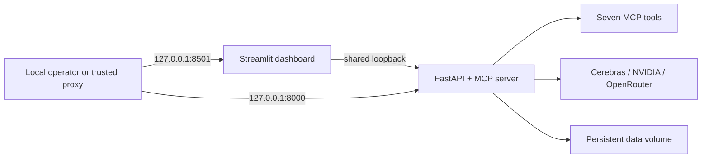

# Deployment

## Supported v1.0.0 deployment profile

The supported release profile is a single-host Docker Compose deployment with the API and dashboard published only on `127.0.0.1`. ToolBridge does not provide inbound authentication in v1.0.0, so it must not be exposed directly to the public internet.



The two containers share one network namespace. This lets the dashboard use the application-enforced loopback API URL while Docker publishes both ports only to host loopback.

## Build and start

```powershell
Copy-Item .env.example .env
docker compose config --quiet
docker compose build
docker compose up --detach
python scripts/verify_release.py --timeout-seconds 90
```

Provider credentials belong in `.env` for a local operator deployment or in the platform's secret injection mechanism. Never build `.env` into the image. The `.dockerignore` excludes environment files, Git data, tests, caches, and build output.

## Configuration and data

- Configuration is loaded from environment variables using the `TOOLBRIDGE_` prefix and `__` for nesting.
- `.env` persists configuration on the host and is ignored by Git and Docker build context.
- The `toolbridge-data` volume persists `/app/data` for approved SQLite and CSV inputs.
- Set provider `ENABLED=true`, `API_KEY`, and `DEFAULT_MODEL` together.
- Keep readiness provider enforcement disabled unless credentials, network access, quota, and provider availability are operational requirements.

## Container controls

- multi-stage Python 3.12 slim build
- fixed non-root UID/GID 10001
- read-only root filesystem and bounded `/tmp`
- all Linux capabilities dropped and `no-new-privileges` enabled
- health checks for API and dashboard
- graceful application lifespan shutdown
- restart policy `unless-stopped`

## Health and rollback

Check status with:

```powershell
docker compose ps
docker compose logs --no-color --tail 100
python scripts/verify_release.py
```

For rollback, retain the previous immutable image tag and configuration backup, change the Compose image tag, and recreate the services. Do not delete the named volume during rollback unless the data is intentionally disposable and backed up.

## Public or multi-user deployment

Direct public exposure is unsupported. A future deployment may place ToolBridge behind a trusted TLS identity-aware proxy and network policy after an explicit authentication and authorization review. See [KNOWN_LIMITATIONS.md](KNOWN_LIMITATIONS.md) and [PRODUCTION_CHECKLIST.md](PRODUCTION_CHECKLIST.md).
