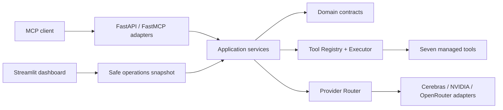

# ToolBridge MCP Server

ToolBridge is a production-oriented Model Context Protocol server that exposes seven validated tools, routes LLM work across three replaceable providers, and provides a read-only operational dashboard.

**Release:** `1.0.0`
**Phase:** Phase 7 - Deployment & v1.0.0 Release prepared; awaiting owner approval
**Runtime:** Python 3.12
**Transport:** MCP Streamable HTTP

## What is included

- strict MCP tool discovery, request/response validation, execution timeouts, normalized errors, and structured logging
- Cerebras -> NVIDIA -> OpenRouter provider priority with bounded retry, failover, health, latency, usage, and normalized responses
- reusable tool lifecycle with automatic registry integration, validation, timing, health, metrics, and safe logging
- Stock Price, Website Reader, SQL Query, CSV Analysis, Currency Converter, HCL Curie Analysis, and System Status tools
- FastAPI liveness, readiness, operations snapshot, OpenAPI, and graceful lifespan shutdown
- read-only Streamlit dashboard for system, provider, tool, metric, cost, and bounded safe-log views
- multi-stage non-root Docker image, loopback-only Compose stack, GitHub Actions CI, and release smoke validation

## Architecture



Dependencies point inward: Domain <- Application <- Adapters <- Infrastructure. FastAPI, MCP, Streamlit, HTTP, SQLite, files, and vendor APIs remain replaceable outer concerns.

## Quick start with Docker

```powershell
docker compose up --build --detach
python scripts/verify_release.py
```

Open the dashboard at `http://127.0.0.1:8501` and API docs at `http://127.0.0.1:8000/docs`. Docker publishes both ports only to host loopback because v1.0.0 does not include inbound authentication.

## Local development

```powershell
python -m venv .venv
.\.venv\Scripts\Activate.ps1
python -m pip install --requirement requirements-dev.txt
Copy-Item .env.example .env
python -m uvicorn toolbridge.main:app --host 127.0.0.1 --port 8000
```

Run the dashboard in another terminal:

```powershell
python -m streamlit run toolbridge/dashboard/app.py --server.address 127.0.0.1 --server.port 8501
```

Providers are disabled by default. To enable one, set its `ENABLED`, `API_KEY`, and `DEFAULT_MODEL` values in the ignored `.env` file. Never commit credentials.

## Interfaces

| Interface | URL |
| --- | --- |
| Service identity | `GET /` |
| Liveness | `GET /health` |
| Readiness | `GET /ready` |
| Safe operations | `GET /operations/snapshot` |
| OpenAPI | `GET /docs` |
| MCP Streamable HTTP | `/mcp/` |
| Streamlit dashboard | `http://127.0.0.1:8501` |

Tool discovery returns the authoritative input and output schemas. See [API_GUIDE.md](API_GUIDE.md) and [USER_GUIDE.md](USER_GUIDE.md).

## Quality gates

```powershell
python -m pip check
python -m ruff format --check toolbridge tests scripts
python -m ruff check toolbridge tests scripts
python -m pytest tests
docker compose config --quiet
```

CI runs these gates on every push and pull request, starts the local API/dashboard, builds the image, starts the Compose stack, and verifies health, readiness, registrations, dashboard health, and safe monitoring output. Tagged releases also produce a compressed image artifact and SHA-256 file; CI does not deploy or publish automatically.

## Security boundary

ToolBridge validates and bounds external input, never logs secrets/prompts/tool payloads, confines local data access, and runs containers non-root with a read-only root filesystem. It has no inbound authentication, authorization, tenants, or application rate limits. Do not expose it directly to public or untrusted networks. Review [SECURITY_GUIDELINES.md](SECURITY_GUIDELINES.md), [KNOWN_LIMITATIONS.md](KNOWN_LIMITATIONS.md), and [PRODUCTION_CHECKLIST.md](PRODUCTION_CHECKLIST.md).

## Documentation

- Setup and operation: [INSTALLATION.md](INSTALLATION.md), [DEPLOYMENT.md](DEPLOYMENT.md), [TROUBLESHOOTING.md](TROUBLESHOOTING.md)
- Usage: [USER_GUIDE.md](USER_GUIDE.md), [API_GUIDE.md](API_GUIDE.md)
- Engineering: [ARCHITECTURE.md](ARCHITECTURE.md), [CODING_STANDARDS.md](CODING_STANDARDS.md), [TESTING_STRATEGY.md](TESTING_STRATEGY.md), [CONTRIBUTING.md](CONTRIBUTING.md)
- Governance: [PROJECT_RULES.md](PROJECT_RULES.md), [DECISIONS.md](DECISIONS.md), [ROADMAP.md](ROADMAP.md), [TASKS.md](TASKS.md)
- Release: [RELEASE_NOTES_v1.0.0.md](RELEASE_NOTES_v1.0.0.md), [CHANGELOG.md](CHANGELOG.md), [PROJECT_STATUS.md](PROJECT_STATUS.md)

Phase 7 changes are prepared but intentionally uncommitted and unpushed pending owner approval. Suggested tag: `v1.0.0`.
