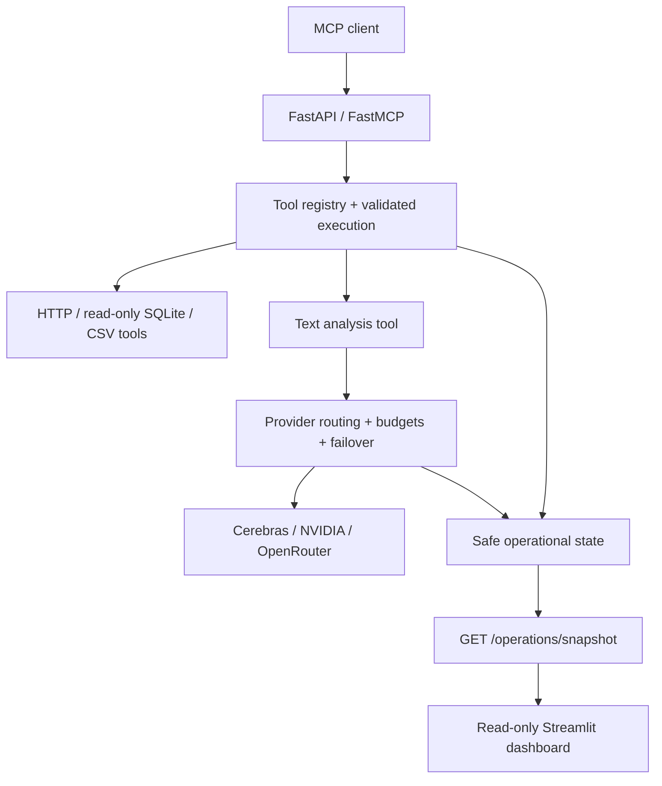

# ToolBridge MCP Server

**One interface for AI assistants to discover and use tools for APIs, local data, and text analysis.**

ToolBridge is a Python project that exposes seven tools through the Model Context Protocol (MCP). It validates requests, keeps data access bounded, and routes text analysis through interchangeable LLM providers. A read-only dashboard shows service health and execution metrics.

**Version:** v1.1.0 | **Python:** 3.12 | **Deployment:** local or trusted single-host

[Five-minute interview demo](docs/DEMO.md) | [Architecture](ARCHITECTURE.md) | [Installation](INSTALLATION.md) | [Screenshot gallery](screenshots/README.md)

## The problem it solves

Connecting an AI assistant to a database, a website, and a model provider often means writing separate integration code for each dependency. Validation, error handling, and vendor-specific behavior can become tangled together.

ToolBridge gives compatible clients a shared way to discover tools and call them with structured arguments. Behind that interface, each tool owns a bounded task, and provider adapters keep vendor details separate from application logic.

For example, a client can discover `sql_query`, submit a read-only query, and receive structured rows. An attempted SQL write is rejected before database execution. The dashboard shows operational activity without displaying the query or its result.

## See it working

| Operations dashboard | Successful MCP tool call |
| --- | --- |
|  |  |
| Service health, version, and local readiness. | A captured successful `system_status` execution. |

The [full gallery](screenshots/README.md) includes seven-tool discovery, SQL write rejection, and captured live NVIDIA, stock-price, and currency-conversion results. These are point-in-time validation captures.

## What I built

- **A discoverable tool interface:** FastAPI and FastMCP expose seven tools with strict Pydantic input/output schemas and normalized failures.
- **Bounded data access:** read-only SQL controls, confined CSV paths, website destination checks, timeouts, and response limits.
- **A provider plugin layer:** Cerebras, NVIDIA, and OpenRouter adapters share provider-neutral contracts, with capability-aware routing, bounded retries, failover, and estimated budget controls.
- **Operational visibility:** health and readiness endpoints plus a read-only Streamlit dashboard that excludes prompts, tool payloads, and credentials.
- **Repeatable validation and packaging:** automated tests, GitHub Actions checks, and a non-root Docker/Compose setup.

## Available tools

| Tool | What it does | Dependency or boundary |
| --- | --- | --- |
| `system_status` | Returns local service status | No external dependency |
| `sql_query` | Returns bounded SQLite query results | Conservative read-only SQL validation |
| `csv_analysis` | Summarizes a configured local CSV | Confined file paths and size limits |
| `website_reader` | Extracts bounded text from a web page | Public HTTPS destinations by default |
| `stock_price` | Retrieves a market quote | External market-data service |
| `currency_converter` | Converts an amount to multiple currencies | External exchange-rate service |
| `llm_analysis` | Analyzes or summarizes text | An enabled LLM provider |

MCP `tools/list` returns the authoritative input and output schemas. LLM providers are disabled by default; enabling one requires configuration and credentials.

## How it works



The code follows Clean Architecture: domain and application logic sit inside replaceable adapters and infrastructure. Provider adapters translate vendor behavior into shared application contracts. See [ARCHITECTURE.md](ARCHITECTURE.md) for the detailed flows.

### Design decisions and tradeoffs

| Decision | Why it helps | Tradeoff |
| --- | --- | --- |
| Strict schemas and bounded execution | Reject malformed requests and limit resource use | Clients must follow explicit contracts |
| Read-only SQL | Supports analysis while restricting mutation | Conservative validation rejects some valid complex queries |
| Provider-neutral interfaces | Keep vendor details out of routing and tools | Each adapter must normalize vendor behavior |
| Process-local operational state | Keeps the single-process setup simple | Metrics and budget estimates reset on restart |
| Loopback-only deployment | Supports local use within the current security boundary | Public access requires additional controls |

## Run locally

For first-time setup, follow [INSTALLATION.md](INSTALLATION.md). These commands assume Python 3.12 and the project `.venv` are already installed. Run them from the repository root in separate PowerShell terminals.

Start the API and MCP server:

```powershell
.\.venv\Scripts\python.exe -m uvicorn toolbridge.main:app --host 127.0.0.1 --port 8000
```

Start the dashboard:

```powershell
.\.venv\Scripts\python.exe -m streamlit run toolbridge/dashboard/app.py --server.address 127.0.0.1 --server.port 8501
```

Open the [dashboard](http://127.0.0.1:8501) or [API documentation](http://127.0.0.1:8000/docs). The MCP endpoint is `http://127.0.0.1:8000/mcp/`.

The [five-minute demo](docs/DEMO.md) includes startup settings for a credential-free walkthrough, copyable requests, expected results, and interview talking points.

## Demo data

The repository ships small sample data so `sql_query` and `csv_analysis` work out of the box:

- `data/demo.db` holds the tables `companies` (10 US and Indian tickers) and `financials` (FY2024–2025 revenue and net income). These are **illustrative demo values, not authoritative financials**. It is the default `TOOLBRIDGE_PHASE5__SQL_QUERY__DATABASE_PATH`.
- `data/csv/sample_sales.csv` holds 60 orders, including one missing value. `data/csv/sample_stock_prices.csv` holds 20 days of OHLCV for AAPL, RELIANCE.NS and NVDA.

Example MCP arguments:

```json
{"query": "SELECT c.name, f.revenue_billion FROM companies c JOIN financials f ON f.ticker = c.ticker WHERE c.country = :country AND f.fiscal_year = 2025", "parameters": {"country": "IN"}}
{"relative_path": "sample_sales.csv", "preview_rows": 5}
```

To regenerate the files, run `python scripts/seed_demo_data.py`. Set `DATABASE_PATH=:memory:` to disable the demo database.

## Testing and evidence

The latest local validation completed with **185 passing tests** and no warnings. mypy also passes (`python -m mypy`). Earlier retained screenshots show the historical 133-test baseline. Ruff lint and formatting passes are recorded in the existing validation evidence. The tests cover validation, execution, provider routing, tool adapters, operations, and dashboard behavior.

Reproduce the checks locally:

```powershell
.\.venv\Scripts\python.exe -m pip check
.\.venv\Scripts\python.exe -m ruff format --check toolbridge tests scripts
.\.venv\Scripts\python.exe -m ruff check toolbridge tests scripts
.\.venv\Scripts\python.exe -m mypy
.\.venv\Scripts\python.exe -m pytest tests
```

Captured manual evidence includes discovery of all seven tools, successful NVIDIA text analysis, AAPL market data, currency conversion, and SQL write rejection. Live results depend on upstream availability, configuration, and credentials where required. See the [evidence gallery](screenshots/README.md) and [testing strategy](TESTING_STRATEGY.md).

GitHub Actions also checks startup, image builds, Compose configuration, and release smoke behavior. Tagged builds produce an image archive and SHA-256 artifact; they do not automatically publish or deploy it. The historical `v1.1.0` release is commit `4d8d73bb3ffa63102c7059429f14b459eb668546`; later portfolio captures are separate evidence.

## Current scope and limitations

ToolBridge supports local or trusted single-host use. Docker Compose publishes ports only on `127.0.0.1` and runs containers as non-root with read-only roots and restricted capabilities.

There is no inbound authentication, authorization, tenant isolation, or application rate limiting, so the service must not be exposed directly to a public or untrusted network. Metrics, recent logs, health state, caches, and provider budget estimates are process-local and reset on restart. Estimated costs are not authoritative billing records.

Public deployment would require identity and access controls, rate limits, persistent audit/operational storage, and deployment-specific security review. See [KNOWN_LIMITATIONS.md](KNOWN_LIMITATIONS.md) and [SECURITY_GUIDELINES.md](SECURITY_GUIDELINES.md).

## Explore further

| Looking for | Start here |
| --- | --- |
| A short working demonstration | [Interview demo](docs/DEMO.md) |
| Technical design | [Architecture](ARCHITECTURE.md) and [decisions](DECISIONS.md) |
| Setup and troubleshooting | [Installation](INSTALLATION.md) and [troubleshooting](TROUBLESHOOTING.md) |
| Request examples and contracts | [API examples](docs/API-EXAMPLES.md) and [API guide](API_GUIDE.md) |
| Project and resume material | [Project summary](docs/PROJECT-SUMMARY.md) and [resume material](docs/RESUME.md) |
| Deployment details | [Deployment](DEPLOYMENT.md) and [production checklist](PRODUCTION_CHECKLIST.md) |
