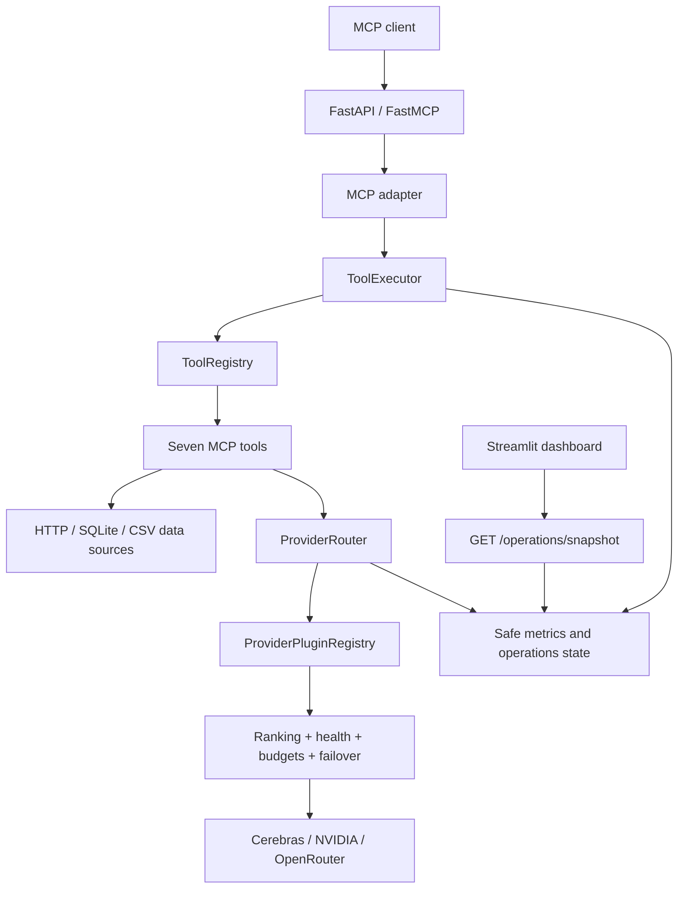

# ToolBridge MCP Server

ToolBridge is a local-first Model Context Protocol (MCP) server that exposes seven strictly validated tools through FastMCP, routes LLM work through self-registering provider plugins, and presents secret-safe operational state in a read-only Streamlit dashboard.

- **Release:** `v1.1.0`
- **Runtime:** Python 3.12
- **Transport:** MCP Streamable HTTP
- **Status:** Approved roadmap complete; automated and owner manual validation passed

## Problem and solution

AI clients often need access to external data and model providers, but direct integrations couple protocol handling, validation, vendor APIs, local data access, and operations into one boundary. ToolBridge uses MCP as the client-facing contract and Clean Architecture internally so tools, providers, transports, and infrastructure can evolve independently.

The release provides deterministic tool discovery, schema-validated execution, normalized errors, bounded external work, provider selection controls, and an operational view that excludes prompts, tool payloads, paths, SQL, URLs, credentials, and provider response bodies.

## Engineering highlights

- seven MCP tools with strict Pydantic input/output schemas, timeouts, response bounds, and normalized failures
- FastAPI control plane plus FastMCP Streamable HTTP initialization, discovery, and execution
- self-registering Cerebras, NVIDIA, and OpenRouter plugins discovered without router vendor switches
- capability-aware model ranking using availability, health, latency, configured cost, and reasoning quality
- optional provider priority, bounded retry/failover, health scoring, and daily/monthly/per-request budget controls
- read-only health, readiness, operations snapshot, and Streamlit monitoring interfaces
- multi-stage non-root Docker image, loopback-only Compose publication, and GitHub Actions validation
- 133 passing automated tests plus owner manual validation of HTTP, MCP, dashboard, security, and live integration behavior

## Architecture



Dependencies point inward: Domain <- Application <- Adapters <- Infrastructure. FastAPI, FastMCP, Streamlit, HTTP clients, SQLite, files, and vendor APIs remain replaceable outer concerns. See [ARCHITECTURE.md](ARCHITECTURE.md) for the detailed component, provider, request, operations, and deployment flows.

## Project screenshots

| Operations overview | MCP tool registry |
| --- | --- |
|  |  |
| Version, health, and local readiness checks for the released v1.1.0 service. | All seven tools registered with healthy local lifecycle state; point-in-time live execution evidence appears below. |

| Provider plugin platform | Successful MCP execution |
| --- | --- |
|  |  |
| Cerebras, NVIDIA, and OpenRouter plugin metadata with providers truthfully disabled and failover on standby. | Structured `system_status` output successfully returned through the validated MCP path. |

### Verified Live Validation

| Seven-tool discovery + NVIDIA LLM | Live AAPL market data |
| --- | --- |
|  |  |
| MCP initialized, discovered all seven tools, and executed `hcl_curie_analysis` through NVIDIA using `meta/llama-3.1-8b-instruct`, with token accounting returned. | `stock_price` returned point-in-time AAPL data through MCP using Yahoo Finance; this is captured validation, not an availability guarantee. |

**SQL write rejection**


The attempted `DELETE FROM users` request was rejected by validation. Additional captured evidence records [133 passing automated tests](screenshots/07-automated-tests-133-passed.png) and [USD-to-INR/EUR conversion through Frankfurter](screenshots/11-live-currency-converter-mcp.png).

See the [complete 12-screenshot gallery](screenshots/README.md) for health and readiness responses, full technical context, and interpretation boundaries.

## MCP tools

| Tool | Purpose | Operational boundary |
| --- | --- | --- |
| `system_status` | Return local service status | No input or external dependency |
| `stock_price` | Retrieve a current market quote | External provider/network dependent |
| `website_reader` | Extract bounded text from a web page | Public HTTPS destinations by default |
| `sql_query` | Execute a bounded SQLite query | Conservative read-only `SELECT`/CTE validation |
| `csv_analysis` | Summarize a configured local CSV | Root-confined and size/row/column bounded |
| `currency_converter` | Convert one amount to multiple currencies | External rate-provider/network dependent |
| `hcl_curie_analysis` | Analyze or summarize text | Requires an enabled LLM provider |

Discovery through `tools/list` is the authoritative source for every input and output schema.

## Provider platform

Cerebras, NVIDIA, and OpenRouter are built-in plugins. Each plugin contributes its identifier, factory, default capabilities, and typed configuration. At startup, enabled plugins are health-checked and their model metadata is discovered. The router filters by required capabilities, evaluates health/latency/cost/quality, enforces configured budgets, retries eligible failures, and can fail over to another eligible provider.

Providers are disabled by default. A later point-in-time portfolio validation successfully executed `hcl_curie_analysis` through MCP using NVIDIA and `meta/llama-3.1-8b-instruct`. Live execution still depends on owner-supplied configuration and credentials, network access, quota, model availability, and provider terms; the captured result does not imply permanent availability or an SLA.

## Five-minute local demo

Use the existing project virtual environment:

```powershell
.\.venv\Scripts\python.exe -m uvicorn toolbridge.main:app --host 127.0.0.1 --port 8000
```

In a second terminal:

```powershell
.\.venv\Scripts\python.exe -m streamlit run toolbridge/dashboard/app.py --server.address 127.0.0.1 --server.port 8501
```

Open `http://127.0.0.1:8501`, or follow the complete [5-10 minute recruiter demo](docs/DEMO.md). Copyable HTTP/MCP commands are in [docs/API-EXAMPLES.md](docs/API-EXAMPLES.md), with request bodies in [examples/](examples/).

For a fresh installation, follow [INSTALLATION.md](INSTALLATION.md) rather than assuming `.venv` already exists.

## Interfaces

| Interface | Local URL |
| --- | --- |
| Service identity | `GET http://127.0.0.1:8000/` |
| Liveness | `GET http://127.0.0.1:8000/health` |
| Readiness | `GET http://127.0.0.1:8000/ready` |
| Safe operations | `GET http://127.0.0.1:8000/operations/snapshot` |
| OpenAPI | `http://127.0.0.1:8000/docs` |
| MCP Streamable HTTP | `http://127.0.0.1:8000/mcp/` |
| Streamlit dashboard | `http://127.0.0.1:8501` |

## Validation evidence

Release `v1.1.0` is commit `4d8d73bb3ffa63102c7059429f14b459eb668546`. The later portfolio/manual evidence summarized below does not change that historical release commit.

### Deterministic automated validation

The current pytest suite completed with 133 passing tests and one non-failing Starlette/httpx deprecation warning. Ruff lint and Ruff format checks passed.

```powershell
.\.venv\Scripts\python.exe -m pip check
.\.venv\Scripts\python.exe -m ruff format --check toolbridge tests scripts
.\.venv\Scripts\python.exe -m ruff check toolbridge tests scripts
.\.venv\Scripts\python.exe -m pytest tests
docker compose config --quiet
```

### Point-in-time manual and live validation

- MCP initialization succeeded and discovered all seven tools: `csv_analysis`, `currency_converter`, `hcl_curie_analysis`, `sql_query`, `stock_price`, `system_status`, and `website_reader`.
- `hcl_curie_analysis` executed through MCP using NVIDIA and `meta/llama-3.1-8b-instruct`; `stock_price` returned AAPL market data using Yahoo Finance; and `currency_converter` converted USD to INR and EUR using Frankfurter.
- `website_reader` retrieved `https://example.com/`; `csv_analysis` analyzed a controlled local CSV; and `sql_query` executed a bounded read-only `SELECT` query.
- `/health` returned `status=ok`, while `/ready` returned `ready=true` and confirmed seven registered tools.
- The destructive `DELETE FROM users` SQL request was rejected. Invalid HTTP website input, invalid stock-symbol input, and an invalid `hcl_curie_analysis` operation were also rejected during manual security validation.

These live-provider results are point-in-time evidence. They remain dependent on configuration, credentials where required, network access, quota, upstream availability, and provider terms, and do not imply production availability or SLAs.

CI runs dependency, formatting, lint, test, startup, image-build, Compose, and release-smoke gates. Tagged builds produce an image archive and SHA-256 artifact; CI does not publish or deploy it automatically.

## Deployment and security boundary

The supported release profile is local or trusted single-host Docker Compose. Both host ports are published only on `127.0.0.1`; containers run non-root with read-only roots, bounded temporary storage, dropped Linux capabilities, and `no-new-privileges`.

ToolBridge has no inbound authentication, authorization, tenants, persistent audit backend, or application rate limits. It must not be exposed directly to a public or untrusted network. Metrics, health, budgets, caches, and recent logs are process-local and reset on restart. See [SECURITY_GUIDELINES.md](SECURITY_GUIDELINES.md), [KNOWN_LIMITATIONS.md](KNOWN_LIMITATIONS.md), and [PRODUCTION_CHECKLIST.md](PRODUCTION_CHECKLIST.md).

## Portfolio and documentation

- Recruiter overview: [docs/PROJECT-SUMMARY.md](docs/PROJECT-SUMMARY.md)
- Resume material and interview answers: [docs/RESUME.md](docs/RESUME.md)
- Live demo sequence: [docs/DEMO.md](docs/DEMO.md)
- HTTP and MCP examples: [docs/API-EXAMPLES.md](docs/API-EXAMPLES.md)
- Genuine screenshot gallery: [screenshots/README.md](screenshots/README.md)
- Architecture: [ARCHITECTURE.md](ARCHITECTURE.md)
- Setup and deployment: [INSTALLATION.md](INSTALLATION.md), [DEPLOYMENT.md](DEPLOYMENT.md), [TROUBLESHOOTING.md](TROUBLESHOOTING.md)
- Usage and contracts: [USER_GUIDE.md](USER_GUIDE.md), [API_GUIDE.md](API_GUIDE.md)
- Testing and status: [TESTING_STRATEGY.md](TESTING_STRATEGY.md), [PROJECT_STATUS.md](PROJECT_STATUS.md), [CHANGELOG.md](CHANGELOG.md)
