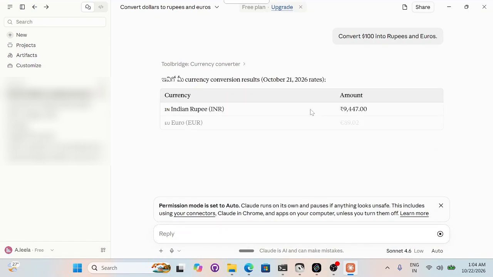
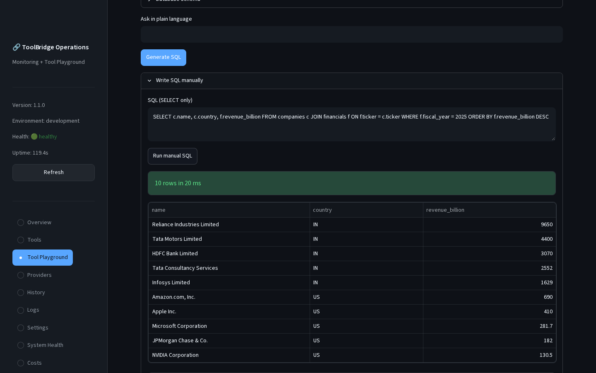
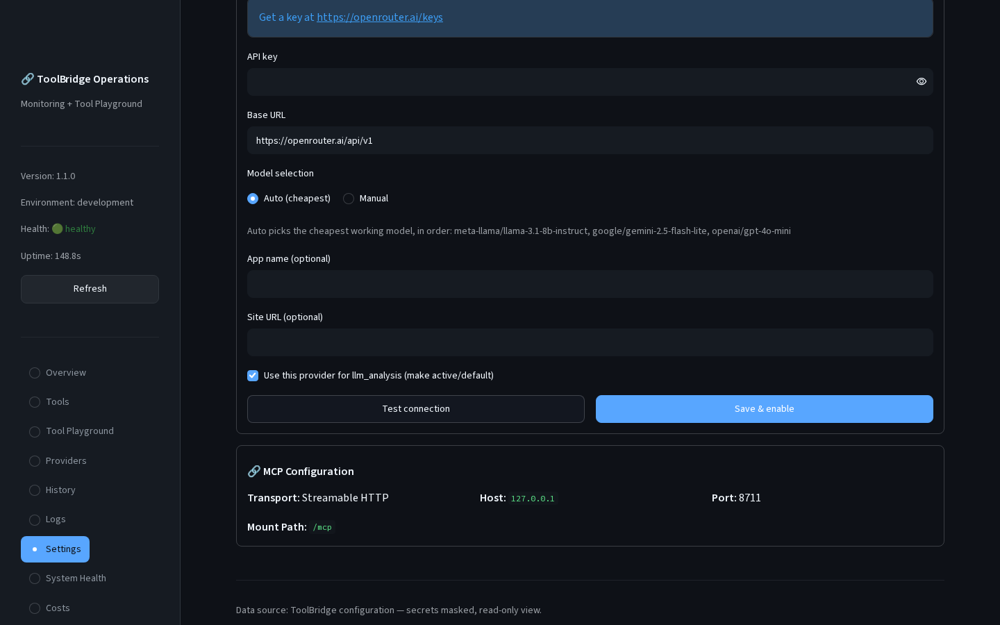
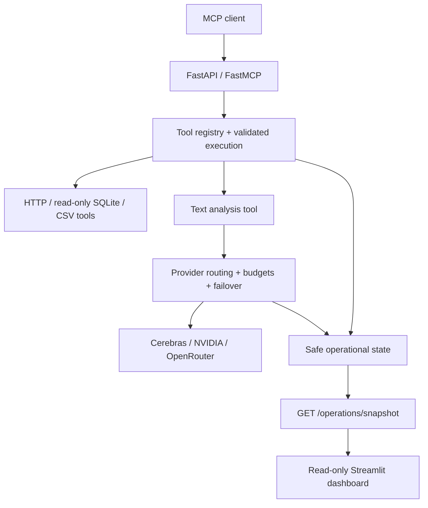

# ToolBridge MCP Server

**One interface for AI assistants to discover and use tools for APIs, local data, and text analysis.**

ToolBridge is a Python project that exposes seven tools through the Model Context Protocol (MCP). It validates requests, keeps data access bounded, and routes text analysis through interchangeable LLM providers. A read-only dashboard shows service health and execution metrics.

**Version:** v1.1.0 | **Python:** 3.12 | **Tests:** 228 passing | **License:** MIT | **Deployment:** local or trusted single-host

[Five-minute interview demo](docs/DEMO.md) | [Architecture](ARCHITECTURE.md) | [Installation](docs/INSTALLATION.md) | [Screenshot gallery](screenshots/README.md)

## The problem it solves

Connecting an AI assistant to a database, a website, and a model provider often means writing separate integration code for each dependency. Validation, error handling, and vendor-specific behavior can become tangled together.

ToolBridge gives compatible clients a shared way to discover tools and call them with structured arguments. Behind that interface, each tool owns a bounded task, and provider adapters keep vendor details separate from application logic.

For example, a client can discover `sql_query`, submit a read-only query, and receive structured rows. An attempted SQL write is rejected before database execution. The dashboard shows operational activity without displaying the query or its result.

## See it working

<!-- DEMO VIDEO LINK: replace both occurrences of https://VIDEO_LINK below with the shared video link
     (for a Drive file use https://drive.google.com/file/d/<FILE_ID>/preview so it plays directly). -->
[](https://VIDEO_LINK)

▶ [Watch the ToolBridge demo video](https://VIDEO_LINK)
<!-- END DEMO VIDEO LINK -->

**Claude Desktop calling ToolBridge through the stdio bridge** (`Convert $100 into Rupees and Euros` → `currency_converter`)



| Tool Playground | Guided provider setup |
| --- | --- |
|  |  |
| Any tool, run through the real MCP endpoint, with readable results and raw JSON. | Paste a key once (never shown again), pick Auto (cheapest) or a model, test, save. |

The [evidence gallery](screenshots/README.md) adds seven-tool discovery, SQL write rejection, and captured live NVIDIA, stock-price, and currency-conversion results (point-in-time captures).

## What I built

- **A discoverable tool interface:** FastAPI and FastMCP expose seven tools with strict Pydantic input/output schemas and normalized failures.
- **Bounded data access:** read-only SQL controls, confined CSV paths, website destination checks, timeouts, and response limits.
- **A provider plugin layer:** Cerebras, NVIDIA, and OpenRouter adapters share provider-neutral contracts, with capability-aware routing, bounded retries, failover, and estimated budget controls.
- **Operational visibility:** health and readiness endpoints plus a read-only Streamlit dashboard that excludes prompts, tool payloads, and credentials.
- **Tool Playground:** a dashboard page that runs any tool through the real MCP endpoint (JSON-RPC `tools/call`), with demo examples, plain-language-to-SQL, CSV upload, and text or audio input for `llm_analysis`.
- **Guided provider setup with auto model choice:** pick OpenRouter, OpenAI, Anthropic, Gemini, Groq, Cerebras, NVIDIA, or any OpenAI-compatible endpoint, paste the key once (write-only), and let **Auto (cheapest)** pick the cheapest working model, free models first.
- **LLM analysis:** `llm_analysis` analyzes or summarizes untrusted text through the provider router, with retries, failover, and budget limits.
- **Claude Desktop stdio bridge:** `python -m toolbridge.stdio_bridge` relays MCP from Claude Desktop (or any stdio MCP client) to the running server, so desktop calls also appear in History and Logs.
- **Demo data and logs:** fictional SQL/CSV/text samples plus 12 success and 10 error requests in `examples/demo-data`; History and Logs pages show sanitized activity only.
- **Repeatable validation and packaging:** 228 automated tests, GitHub Actions checks, and a non-root Docker/Compose setup.

## Available tools

| Tool | What it does | Dependency or boundary |
| --- | --- | --- |
| `system_status` | Returns local service status | No external dependency |
| `sql_query` | Returns bounded SQLite query results | Conservative read-only SQL validation |
| `csv_analysis` | Summarizes a configured local CSV | Confined file paths and size limits |
| `website_reader` | Extracts bounded text from a web page | Public HTTPS destinations by default |
| `stock_price` | Retrieves a market quote | External market-data service |
| `currency_converter` | Converts an amount to multiple currencies | External exchange-rate service |
| `llm_analysis` | Analyzes or summarizes text | An enabled LLM provider |

MCP `tools/list` returns the authoritative input and output schemas. LLM providers are disabled by default; enabling one requires configuration and credentials.

## How it works



The code follows Clean Architecture: domain and application logic sit inside replaceable adapters and infrastructure. Provider adapters translate vendor behavior into shared application contracts. See [ARCHITECTURE.md](ARCHITECTURE.md) for the detailed flows.

### Design decisions and tradeoffs

| Decision | Why it helps | Tradeoff |
| --- | --- | --- |
| Strict schemas and bounded execution | Reject malformed requests and limit resource use | Clients must follow explicit contracts |
| Read-only SQL | Supports analysis while restricting mutation | Conservative validation rejects some valid complex queries |
| Provider-neutral interfaces | Keep vendor details out of routing and tools | Each adapter must normalize vendor behavior |
| Process-local operational state | Keeps the single-process setup simple | Metrics and budget estimates reset on restart |
| Loopback-only deployment | Supports local use within the current security boundary | Public access requires additional controls |

## Run locally

For first-time setup, follow [INSTALLATION.md](docs/INSTALLATION.md). These commands assume Python 3.12 and the project `.venv` are already installed. Run them from the repository root in separate PowerShell terminals.

Start the API and MCP server:

```powershell
.\.venv\Scripts\python.exe -m uvicorn toolbridge.main:app --host 127.0.0.1 --port 8000
```

Start the dashboard:

```powershell
.\.venv\Scripts\python.exe -m streamlit run toolbridge/dashboard/app.py --server.address 127.0.0.1 --server.port 8501
```

If you start the API on another host or port, point the dashboard at it with `TOOLBRIDGE_OPERATIONS__DASHBOARD_API_URL` (default `http://127.0.0.1:8000`). Copying `.env.example` to `.env` as-is works; blank values fall back to defaults.

Open the [dashboard](http://127.0.0.1:8501) or [API documentation](http://127.0.0.1:8000/docs). The MCP endpoint is `http://127.0.0.1:8000/mcp/`.

The [five-minute demo](docs/DEMO.md) includes startup settings for a credential-free walkthrough, copyable requests, expected results, and interview talking points.

### Use it from Claude Desktop

Keep the API running, then add this entry to Claude Desktop's `claude_desktop_config.json` (Settings → Developer → Edit config), adjusting the paths to your clone. A full example is in [examples/claude_desktop_config.example.json](examples/claude_desktop_config.example.json).

```json
{
  "mcpServers": {
    "toolbridge": {
      "command": "C:\\path\\to\\ToolBridge-MCP-Server\\.venv\\Scripts\\python.exe",
      "args": ["-m", "toolbridge.stdio_bridge"],
      "cwd": "C:\\path\\to\\ToolBridge-MCP-Server",
      "env": { "TOOLBRIDGE_BRIDGE_URL": "http://127.0.0.1:8000/mcp/" }
    }
  }
}
```

Restart Claude Desktop; `toolbridge` shows as **Running** and its seven tools become available. If `TOOLBRIDGE_MCP_AUTH_TOKEN` is set, the bridge reads it from the environment or the project `.env` and sends it as a Bearer token.

### Demo data

The repository ships small sample data so `sql_query` and `csv_analysis` work out of the box:

- `data/demo.db` holds the tables `companies` (10 US and Indian tickers) and `financials` (FY2024–2025 revenue and net income). These are **illustrative demo values, not authoritative financials**. It is the default `TOOLBRIDGE_PHASE5__SQL_QUERY__DATABASE_PATH`.
- `data/csv/sample_sales.csv` holds 60 orders, including one missing value. `data/csv/sample_stock_prices.csv` holds 20 days of OHLCV for AAPL, RELIANCE.NS and NVDA.

Example MCP arguments:

```json
{"query": "SELECT c.name, f.revenue_billion FROM companies c JOIN financials f ON f.ticker = c.ticker WHERE c.country = :country AND f.fiscal_year = 2025", "parameters": {"country": "IN"}}
{"relative_path": "sample_sales.csv", "preview_rows": 5}
```

A richer fictional set (library SQLite database, cafe-orders CSV, text samples, and ready-made MCP requests) lives in [examples/demo-data](examples/demo-data/README.md); point `TOOLBRIDGE_PHASE5__SQL_QUERY__DATABASE_ROOT`/`DATABASE_PATH` and `TOOLBRIDGE_PHASE5__CSV_ANALYSIS__ROOT_DIRECTORY` at it, and the dashboard follows the same values.

To regenerate the files, run `python scripts/seed_demo_data.py`. Set `DATABASE_PATH=:memory:` to disable the demo database.

## Testing and evidence

The suite has **228 passing tests** with no warnings, and Ruff lint/format checks pass. The tests cover validation, execution, provider routing, tool adapters, operations, the dashboard and Tool Playground helpers, `.env.example` loading, and an end-to-end stdio bridge check (a real MCP stdio client lists the seven tools and calls `system_status` through the bridge).

Reproduce the checks locally:

```powershell
.\.venv\Scripts\python.exe -m pip check
.\.venv\Scripts\python.exe -m ruff format --check toolbridge tests scripts
.\.venv\Scripts\python.exe -m ruff check toolbridge tests scripts
.\.venv\Scripts\python.exe -m mypy
.\.venv\Scripts\python.exe -m pytest tests
```

Captured manual evidence includes discovery of all seven tools, successful NVIDIA text analysis, AAPL market data, currency conversion, and SQL write rejection. Live results depend on upstream availability, configuration, and credentials where required. See the [evidence gallery](screenshots/README.md) and [testing strategy](docs/TESTING_STRATEGY.md).

GitHub Actions also checks startup, image builds, Compose configuration, and release smoke behavior. Tagged builds produce an image archive and SHA-256 artifact; they do not automatically publish or deploy it. The historical `v1.1.0` release is commit `4d8d73bb3ffa63102c7059429f14b459eb668546`; later portfolio captures are separate evidence.

## Current scope and limitations

ToolBridge supports local or trusted single-host use. Docker Compose publishes ports only on `127.0.0.1` and runs containers as non-root with read-only roots and restricted capabilities.

Apart from an optional shared MCP bearer token (`TOOLBRIDGE_MCP_AUTH_TOKEN`), there is no inbound authentication, authorization, tenant isolation, or application rate limiting, so the service must not be exposed directly to a public or untrusted network. Metrics, recent logs, health state, caches, and provider budget estimates are process-local and reset on restart. Estimated costs are not authoritative billing records.

Public deployment would require identity and access controls, rate limits, persistent audit/operational storage, and deployment-specific security review. See [KNOWN_LIMITATIONS.md](docs/KNOWN_LIMITATIONS.md) and [SECURITY.md](SECURITY.md).

## Explore further

| Looking for | Start here |
| --- | --- |
| A short working demonstration | [Interview demo](docs/DEMO.md) |
| Technical design | [Architecture](ARCHITECTURE.md) |
| Setup and troubleshooting | [Installation](docs/INSTALLATION.md) and [troubleshooting](docs/TROUBLESHOOTING.md) |
| Request examples and contracts | [API examples](docs/API-EXAMPLES.md) and [API guide](docs/API_GUIDE.md) |
| Project summary | [Project summary](docs/PROJECT-SUMMARY.md) |
| Deployment details | [Deployment](docs/DEPLOYMENT.md) |
