# ToolBridge Screenshot Gallery

These 12 genuine screenshots were captured from the released ToolBridge MCP Server v1.1.0 during portfolio validation. Together they document the operational UI, verified local interfaces, automated test results, MCP tool discovery and execution, point-in-time live external-provider calls, and SQL write-operation rejection.

## 1. Operations Overview

**File:** `01-dashboard-overview.png`

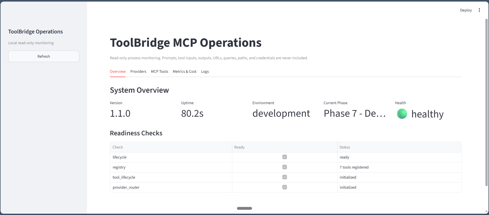

**What it demonstrates:** The read-only Streamlit overview displays version `1.1.0`, development environment, healthy service state, and ready lifecycle, registry, tool-lifecycle, and provider-router checks. The registry reports seven tools.

**Why it matters:** It shows that runtime composition and readiness are observable separately from optional external-provider availability.

## 2. Health Endpoint

**File:** `02-health-endpoint.png`

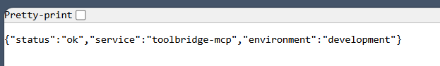

**What it demonstrates:** `GET /health` returns `status=ok`, `service=toolbridge-mcp`, and the local development environment.

**Why it matters:** The endpoint provides cheap process liveness without triggering database, website, market-data, currency, or LLM-provider work.

## 3. Readiness Endpoint

**File:** `03-readiness-endpoint.png`

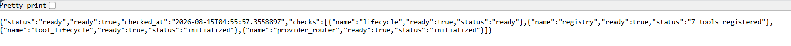

**What it demonstrates:** `GET /ready` returns `ready=true` with successful lifecycle, seven-tool registry, tool-lifecycle, and provider-router initialization checks.

**Why it matters:** Readiness verifies that the local application composition can accept traffic while keeping optional live provider calls outside the check.

## 4. MCP Tool Dashboard

**File:** `04-mcp-tools.png`

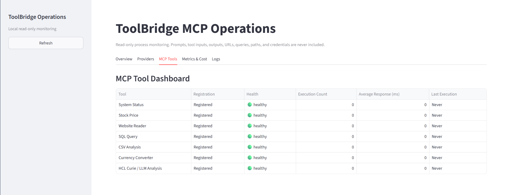

**What it demonstrates:** All seven tools—System Status, Stock Price, Website Reader, SQL Query, CSV Analysis, Currency Converter, and HCL Curie / LLM Analysis—are registered with healthy local lifecycle state.

**Why it matters:** It provides a visual inventory of the stable MCP tool surface. Registered/healthy here means local registration and lifecycle health; it does not claim that every network-dependent tool executed successfully.

## 5. Successful MCP `system_status` Call

**File:** `05-system-status-call.png`

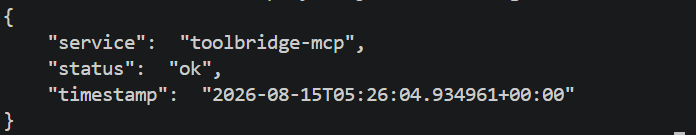

**What it demonstrates:** A successful structured `system_status` result with `service=toolbridge-mcp`, `status=ok`, and a runtime-generated timestamp.

**Why it matters:** It supplies direct evidence of a deterministic tool execution through the validated MCP path, beyond registration alone.

## 6. Provider Plugin Platform

**File:** `06-provider-platform.png`

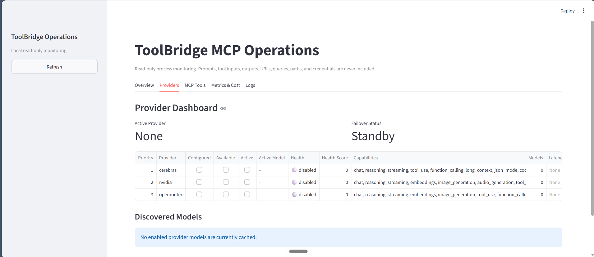

**What it demonstrates:** Cerebras, NVIDIA, and OpenRouter appear in the provider dashboard with priority and capability metadata. The captured local configuration truthfully shows the providers disabled, active provider `None`, failover `Standby`, and no cached enabled-provider models.

**Why it matters:** It shows plugin discovery and secret-safe operational metadata for that captured configuration state. Live provider execution is demonstrated separately in the later MCP validation screenshots.

## 7. Automated Test Suite — 133 Passed

**File:** `07-automated-tests-133-passed.png`

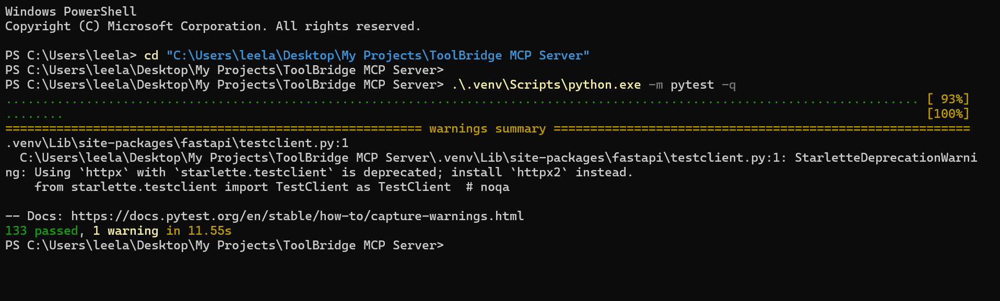

**What it demonstrates:** This is a historical capture of the automated pytest suite completing with 133 passing tests and one non-failing Starlette/httpx deprecation warning. The current suite has 185 passing tests and no warnings; see the README.

**Why it matters:** It provides reproducible evidence that the tested application behavior completed successfully while transparently retaining the dependency warning in the captured output.

## 8. MCP Seven-Tool + NVIDIA Live Test

**File:** `08-mcp-7-tools-nvidia-live-test.png`

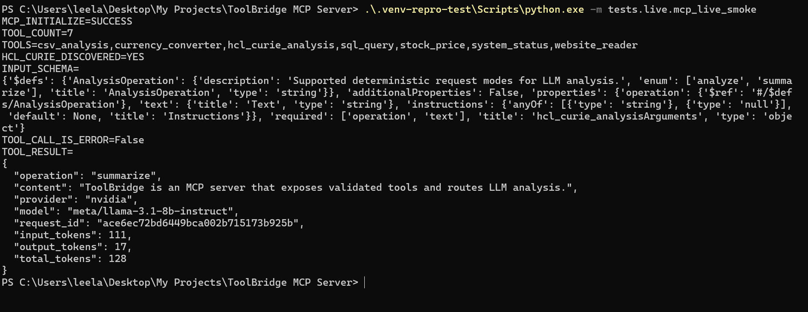

**What it demonstrates:** MCP initialization succeeded, all seven registered tools were discovered, and `hcl_curie_analysis` executed successfully. The result came from NVIDIA using `meta/llama-3.1-8b-instruct` and included input, output, and total token accounting.

**Why it matters:** It captures a successful end-to-end MCP discovery and live LLM-provider execution path with structured provider, model, and usage metadata.

## 9. Health + Readiness — Seven Tools

**File:** `09-health-readiness-7-tools.png`

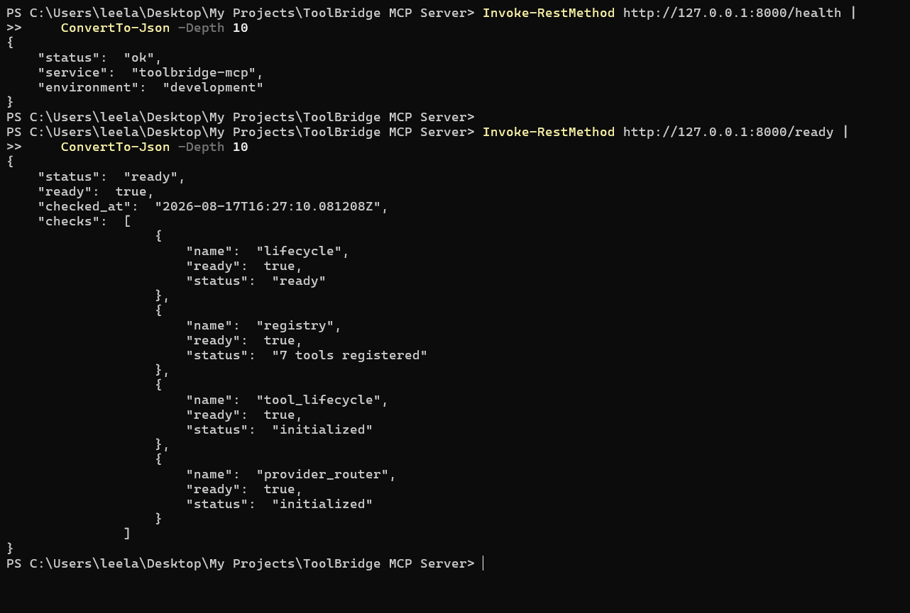

**What it demonstrates:** `/health` returned `status=ok`, and `/ready` returned `ready=true` with lifecycle ready, seven tools registered, tool lifecycle initialized, and provider router initialized.

**Why it matters:** It verifies the service's liveness and complete local readiness composition at the time of capture.

## 10. Live Stock Price via MCP

**File:** `10-live-stock-price-mcp.png`

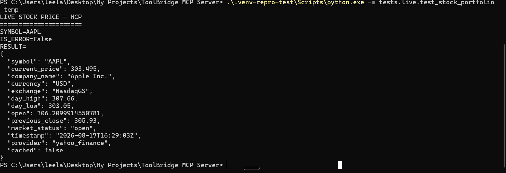

**What it demonstrates:** `stock_price` was successfully called for AAPL through MCP and returned live provider-backed market data from Yahoo Finance.

**Why it matters:** It validates the captured MCP-to-market-data integration path. The screenshot is point-in-time evidence and does not imply permanent provider availability or a production SLA.

## 11. Live Currency Converter via MCP

**File:** `11-live-currency-converter-mcp.png`

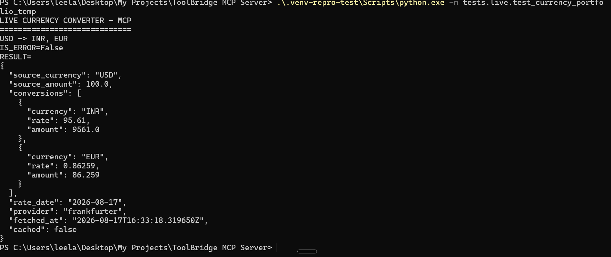

**What it demonstrates:** After the endpoint compatibility fix, `currency_converter` successfully converted USD to INR and EUR using the Frankfurter provider.

**Why it matters:** It records successful MCP currency conversion for the currencies and provider shown in the captured validation, without making broader availability claims.

## 12. SQL Security — Write Operation Rejected

**File:** `12-sql-write-operation-rejected.png`

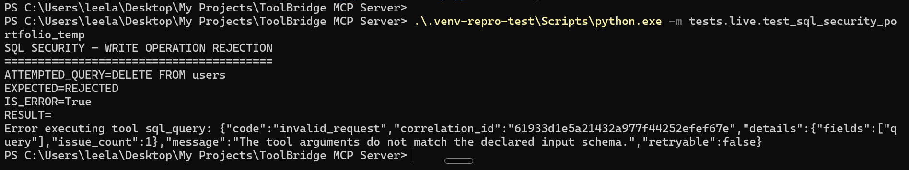

**What it demonstrates:** An attempted `DELETE FROM users` operation was rejected as expected, returning an error rather than executing the write.

**Why it matters:** It provides captured evidence that the validated `sql_query` path did not accept this destructive write request.

## Privacy and Interpretation

The published images were reviewed for visible API keys, bearer tokens, passwords, authorization headers, private email addresses, personal filesystem paths, browser tabs/bookmarks, notifications, and unrelated application content. None were observed.

These screenshots support the documented portfolio-validation scope, including the specific point-in-time NVIDIA, Yahoo Finance, and Frankfurter executions shown. They do not prove public-cloud deployment, production traffic, authentication, persistent distributed state, production availability or SLAs, or successful execution for providers, tools, inputs, and times not captured here.
